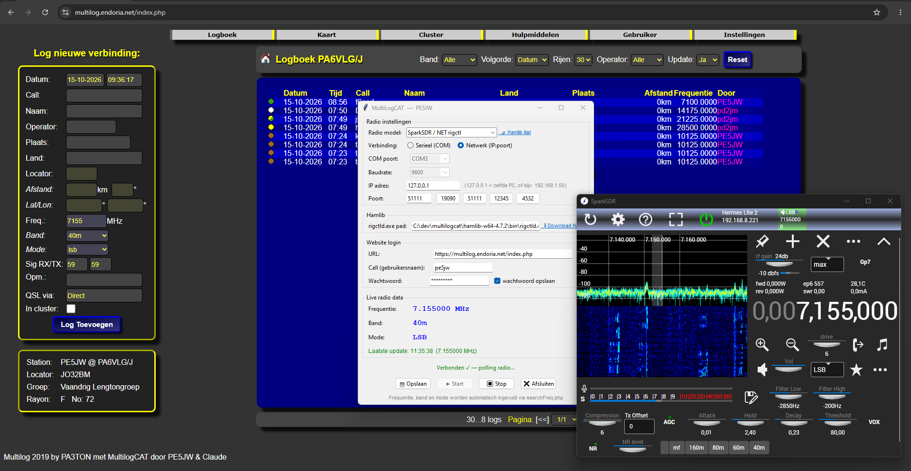

# MultiLogCAT

**Automatisch frequentie, band en mode vanuit de radio invullen in het online [Multilog](https://multilog.endoria.net) logboek.**

Ontwikkeld door PE5JW voor gebruik op JOTA en andere activiteiten met het PA6VLG/J station.


*MultiLogCAT in gebruik op JOTA 2026 — SparkSDR op 40m LSB, frequentie automatisch bijgewerkt in Multilog.*

> ⚠️ **Beta / snel gebouwd voor JOTA 2026**
> Deze app is in korte tijd gemaakt voor een specifiek evenement, weinig getest en kan bugs bevatten.
> Gebruik op eigen risico. Feedback en bugmeldingen welkom via [Issues](../../issues).

---

## Wat doet het?

MultiLogCAT verbindt via **Hamlib / rigctld** (CAT-interface) met je radio en leest elke 2 seconden de actuele frequentie en mode uit. Zodra er iets verandert, worden de velden `freq`, `band` en `mode` in het online Multilog logboek automatisch bijgewerkt via een Playwright-gestuurde Chromium browser.

Je logt zelf de QSO's in — MultiLogCAT zorgt dat de frequentie altijd klopt.

---

## Functies

- Ondersteunt seriële (COM/tty) en netwerk (IP:poort) verbindingen
- Directe verbinding met **SparkSDR** (poort 51111), **FLRig** (12345), **SDR Console** (4532) en rigctld
- Grote lijst van Icom, Yaesu, Kenwood en Elecraft radio's
- Multi-user ondersteuning: wachtwoord optioneel opslaan, login-dialoog bij elk starten
- Windows: bouwbaar als EXE (geen Python vereist op doelcomputer)
- Linux: experimentele ondersteuning (niet getest — zie hieronder)

---

## Platform ondersteuning

| Platform | Status |
|---|---|
| Windows 10/11 | ✅ Getest |
| Linux (Ubuntu/Debian/Fedora) | ⚠️ Experimenteel — **niet getest** |
| macOS | ❓ Onbekend — niet getest |

---

## Installatie

### 🖥️ Windows — EXE (makkelijkst, geen Python nodig)

> Aanbevolen voor de meeste gebruikers.

1. Download `MultiLogCAT-v1.1.2-windows-x64.zip` van de [Releases](../../releases/latest) pagina
2. Pak uit naar een map naar keuze (bijv. `C:\MultiLogCAT\`)
3. Dubbelklik `MultiLogCAT_start.bat`
4. Hamlib (`rigctld.exe`) staat al meegeleverd in de `hamlib\` map — het pad wordt automatisch ingevuld
5. Verwijderen: dubbelklik `uninstall.bat`

---

### 🐍 Windows — Python (voor ontwikkelaars / vanuit broncode)

Vereisten: **Python 3.10+** — download van [python.org](https://www.python.org/downloads/) en vink **"Add Python to PATH"** aan.

1. Download de broncode via de [Releases](../../releases/latest) pagina (Source code zip) of kloon de repository:
   ```bat
   git clone https://github.com/pe5jw/MultilogCat.git
   cd MultilogCat
   ```
2. Dubbelklik `install.bat` — installeert Playwright en Chromium automatisch
3. Start via `start.bat` of `python multilogcat.py`
4. Verwijderen: dubbelklik `uninstall_python.bat`

> Hamlib is **niet nodig** bij gebruik van netwerk-verbindingen (SparkSDR, FLRig, SDR Console).
> Bij seriële (COM) verbinding: installeer Hamlib apart via [github.com/Hamlib/Hamlib/releases](https://github.com/Hamlib/Hamlib/releases/tag/4.7.2) of gebruik de meegeleverde `hamlib\rigctld.exe` uit de EXE-distro.

---

### 🔧 EXE zelf bouwen (vanuit broncode)

Heb je Python en de broncode, en wil je zelf een EXE maken voor distributie?

```bat
build_exe.bat
```

Het script doet automatisch:
1. Installeert PyInstaller en bouwt de EXE
2. Plaatst Chromium naast de EXE in `dist\MultiLogCAT\ms-playwright\`
3. Downloadt Hamlib 4.7.2 en plaatst `rigctld.exe` + DLLs in `dist\MultiLogCAT\hamlib\`
4. Kopieert `uninstall.bat` naar de dist-map
5. Schoont onnodige bestanden op (~140 MB kleiner)

Distribueer de volledige map `dist\MultiLogCAT\` — starten via `MultiLogCAT_start.bat`.

---

### 🐧 Linux ⚠️ experimenteel, niet getest

```bash
chmod +x install_linux.sh
./install_linux.sh
python3 multilogcat.py
```

**Linux-specifieke opmerkingen:**
- Seriële poort: gebruik `/dev/ttyUSB0` of `/dev/ttyS0` (niet `COM3`)
- Rechten seriële poort: `sudo usermod -aG dialout $USER` (daarna uitloggen/inloggen)
- rigctld pad: `which rigctld`

---

## Vereisten (overzicht)

| Software | Versie | Nodig voor |
|---|---|---|
| Python | 3.10+ | Python-versie en EXE bouwen |
| Playwright + Chromium | via pip | Alle versies |
| Hamlib / rigctld | 4.7.2 | Seriële (COM) verbinding — **meegeleverd in EXE-distro** |

---

## Hamlib licentie

Hamlib valt onder de **LGPL v2.1** licentie. De meegeleverde bestanden (`rigctld.exe`, DLLs) zijn ongewijzigd overgenomen van de [officiële Hamlib 4.7.2 release](https://github.com/Hamlib/Hamlib/releases/tag/4.7.2). De licentietekst is meegeleverd in de `hamlib\` map (`LICENSE.txt`, `COPYING.LIB.txt`).

---

## Gebruik

1. Start de app
2. Kies je radio model en verbindingstype
3. Vul de Multilog website URL, call en wachtwoord in
4. Klik **▶ Start**
5. De Chromium browser opent en logt automatisch in
6. Draai op je frequentie — freq, band en mode worden automatisch bijgewerkt

---

## Instellingen (config.json)

De configuratie wordt opgeslagen als `config.json` naast de app (of naast de EXE).
Wachtwoord opslaan is optioneel via het vinkje in de app.
`config.json` staat in `.gitignore` en wordt nooit mee gecommit.

---

## Bekende beperkingen / bugs

- Weinig getest — gemaakt voor JOTA 2026 in beperkte tijd
- Linux ondersteuning is niet getest
- De browser blijft open tijdens gebruik (bewust — zodat je de site ook handmatig kunt bedienen)
- Bij trage internetverbinding kan de injectie van freq/band/mode soms een seconde later zijn

---

## Credits

**Multilog 2019 by [PA3TON](https://multilog.endoria.net)**
MultiLogCAT door PE5JW & Claude (Anthropic)

---

## Licentie

MIT — vrij te gebruiken en aan te passen.
